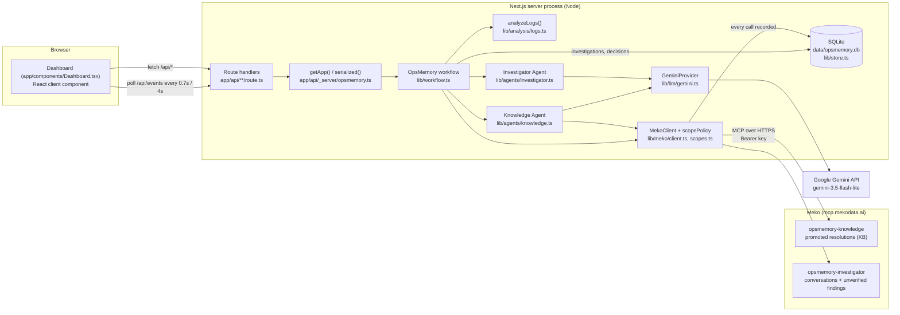

# GRILL_ME.md: OpsMemory from the ground up

An implementation-grounded study guide and code audit for **OpsMemory**. It was written by reading the code as it stands on 2026-11-01, not the original plan. Where the plan and the code differ, **the code wins** and the difference is called out.

> Line numbers refer to the files at the time of writing. Paths are relative to the repository root.

---

## Contents

1. [Product: problem, solution, users, value](#1-product-problem-solution-users-value)
2. [System architecture](#2-system-architecture)
3. [Technology stack](#3-technology-stack)
4. [Frontend architecture](#4-frontend-architecture)
5. [Backend architecture](#5-backend-architecture)
6. [The incident lifecycle, click to result](#6-the-incident-lifecycle-click-to-result)
7. [Knowledge Agent](#7-knowledge-agent)
8. [Investigator Agent](#8-investigator-agent)
9. [Meko integration](#9-meko-integration)
10. [Gemini integration](#10-gemini-integration)
11. [SQLite persistence](#11-sqlite-persistence)
12. [Meko ON versus OFF](#12-meko-on-versus-off)
13. [Human approval and promotion](#13-human-approval-and-promotion)
14. [Security and privacy](#14-security-and-privacy)
15. [Testing: what is actually proven](#15-testing-what-is-actually-proven)
16. [Running and deploying](#16-running-and-deploying)
17. [Limitations, technical debt, known bugs](#17-limitations-technical-debt-known-bugs)
18. [Technical decisions and alternatives](#18-technical-decisions-and-alternatives)
19. [Glossary](#19-glossary)
- [Appendix A: real / deterministic / hardcoded / mock / test-only audit](#appendix-a-real--deterministic--hardcoded--mock--test-only-audit)
- [Appendix B: findings register](#appendix-b-findings-register)

---

## 1. Product: problem, solution, users, value

**Problem.** Cloud teams keep re-investigating failures they have already solved. The fix lives in someone's head, a Slack thread or a postmortem nobody finds. AI agents make this worse: each investigation starts from zero.

**Solution as built.** A two-agent incident investigator whose memory lives in **Meko**:

- A **Knowledge Agent** recalls past knowledge from Meko before any reasoning happens.
- An **Investigator Agent** (Gemini) produces a structured root-cause analysis. Every configuration value it proposes carries its source.
- A **human engineer** approves (optionally editing) or rejects the proposal.
- **Approval stores and promotes** the resolution in Meko. Promotion moves it from private memory into the datapack's shared knowledge base.
- The **next similar incident** recalls that verified resolution, and the dashboard shows exactly which memory was used and how.

**User.** A DevOps or SRE engineer on call. They stay in control: nothing becomes "verified" without their approval, and nothing touches real infrastructure.

**Value proposition, as demonstrated.** In the shipped demo scenarios (`data/scenarios.ts`), incident 2's logs reveal *symptoms*: pool saturation and scale-out. They never reveal the *constraint*: the cluster's 200-connection limit and the 80-connection per-service budget. That constraint exists only in the engineer-approved memory from incident 1. So:

- **Meko ON:** the Investigator recommends `pool max 8, maxReplicas 10`, each value sourced to the promoted memory K1.
- **Meko OFF:** the same model, prompt and logs produce guesses labelled `assumption`, and it asks "what is max_connections?".

**Plan versus code.** The original vision had four agents, a swarm view and five pages. The code has **2 agents and 1 page**. The log and infrastructure "analysts" are a deterministic function (`analyzeLogs`), not agents. Runbook upload exists only in a spike script (§9.7), not in the app.

---

## 2. System architecture



**Key architectural facts:**

- **Thin browser.** It never talks to Meko or Gemini, only to `/api/*`.
- **One process holds everything.** A single `OpsMemory` instance lives on `globalThis` (`app/api/_server/opsmemory.ts:12-17`). Workflow calls are **serialised** through a promise queue (`:19-23`).
- **SQLite is not a memory store.** It holds workflow state and an audit log of Meko calls. Recall only ever comes from Meko.
- **There are two Meko datapacks.** Access between agents is enforced **in app code** by `scopePolicy` (`lib/meko/scopes.ts:40-55`), not by Meko.

---

## 3. Technology stack

| Technology | Version (package.json) | What it does here | Why |
|---|---|---|---|
| **Next.js** (App Router, Turbopack) | ^16.4.3 | Serves the React page and the `/api/*` route handlers in one Node process | One project for UI and backend; server-side routes keep keys off the browser |
| **React** | ^19.3.1 | Client UI (`"use client"` components) | Standard; hooks for polling and state |
| **Tailwind CSS v4** + `@tailwindcss/postcss` | ^4.3.3 | Styling via utility classes; tokens in `app/globals.css` (`@theme inline`) | Fast, consistent dark design without a component library |
| **TypeScript** (strict, `noUncheckedIndexedAccess`) | ^7.0.2 | Types across the UI, API and lib | Catches shape mismatches between Meko, LLM and UI |
| **zod** v4 | ^4.6.7 | Validates Meko responses and LLM JSON; `z.toJSONSchema` feeds Gemini's schema | External data is untrusted; one schema both constrains and validates the model |
| **@modelcontextprotocol/sdk** | ^1.32.2 | MCP client over Streamable HTTP to `https://mcp.mekodata.ai/mcp` | Meko's documented programmatic interface is MCP |
| **@google/genai** | ^2.32.0 | Gemini `generateContent` with `responseJsonSchema` and `thinkingConfig` | Free tier; structured JSON output |
| **node:sqlite** (`DatabaseSync`) | built into Node | Local persistence (`lib/store.ts`) | No extra dependency; synchronous and simple |
| **tsx** | ^4.23.15 | Runs `scripts/*.ts` directly (CLI, e2e, spikes) | No build step for scripts |
| **server-only** | ^0.0.1 | Build fails if `app/api/_server/opsmemory.ts` is imported into client code | Guards keys and Node-only code |
| Inter + JetBrains Mono | via `next/font/google` (`app/layout.tsx`) | Typography | Readable UI and monospaced IDs and logs |

Not used, despite appearing in the plan: Recharts, an agent framework, Postgres, Groq (only planned; `lib/llm/index.ts:24-25` rejects any provider except `gemini`).

---

## 4. Frontend architecture

### 4.1 Pages

- `app/layout.tsx`: root HTML, fonts, `globals.css`.
- `app/page.tsx`: renders `<Dashboard />`. This is the **only page**.

### 4.2 Components (`app/components/`)

| File | Responsibility | Data it reads |
|---|---|---|
| `Dashboard.tsx` | State owner; initial load; event polling; `investigate()` and `decide()` actions; layout; `RunningCard` | `/api/scenarios`, `/api/status`, `/api/investigations`, `/api/events` |
| `IncidentPanel.tsx` | Incident cards, Meko ON/OFF toggle, Investigate button, elapsed timer, raw logs | `Scenario[]` from `/api/scenarios` |
| `Lifecycle.tsx` | Six-stage "memory lifecycle" rail derived from events and decisions | events + selected investigation + all investigations |
| `RecalledMemory.tsx` | Knowledge Agent output: each retrieved item, kind, memory ID, score, why (not) relevant, how used, values taken | `investigation.knowledge`, `investigation.result.outcome.investigation` |
| `InvestigationView.tsx` | Root cause, confidence tile, evidence, remediation, sourced config table, open questions, traceability | `investigation.result` |
| `ApprovalPanel.tsx` | Approve/reject form, "Apply engineer edit", approved/rejected summaries | `investigation.decision`, `scenario.approvalEdit` |
| `Comparison.tsx` | ON versus OFF for the same `incidentRef` | two stored investigations |
| `Timeline.tsx` | Live Meko activity with expandable request/response JSON | events |
| `RunHistory.tsx` | List of stored investigations | `/api/investigations` |
| `ui.tsx` | Primitives: `Panel`, `Chip`, `KIND`, `SOURCE`, `ACTOR`, `Mono`, `Spinner`, `ErrorBox`, `shortId`, `fmtMs` | — |
| `types.ts` | Client types; **type-only** imports from `lib/` (erased at build) | — |

### 4.3 State (all in `Dashboard.tsx`)

The component holds this state with `useState`: `scenarios`, `status`, `investigations`, `events`, `scenarioId`, `mode`, `selectedId`, `running` (`{scenarioId, mode, startedAt}` while a POST is in flight), `busy` (approve or reject in flight), `error`, and the `lastEventTs` ref.

There is no global store library: one component owns the state and passes props down.

### 4.4 API communication

- **The `api<T>()` helper** (`Dashboard.tsx`, top of file) wraps `fetch` with `cache: "no-store"`. A non-2xx response throws the JSON body as `ApiError {error, code?, op?, source?}`.
- **Initial load** (`Dashboard.tsx:46-63`): four GETs in parallel, then the newest investigation is selected.
- **Polling** (`:65-79`): `GET /api/events?since=<lastTs>` every **700ms** while running or busy, and **4000ms** otherwise. New events are appended, keeping the last 400.
- **Investigate** (`:88-101`): `POST /api/investigations {scenarioId, mode, incidentRef?}`, then the list is refreshed and the new run selected. Errors land in `error` and are shown in an `ErrorBox`.
- **Approve or reject** (`:103-117`): `POST /api/investigations/:id/approve|reject`.

### 4.5 How "live" the timeline really is

The Investigate POST is a single blocking request (~20s with Meko ON). While it is pending:

1. The backend's `MekoClient` records each call as it completes.
2. The `MekoEventLog` listener writes it to SQLite immediately (`lib/workflow.ts:82`).
3. The polling GET reads those rows.

So rows appear **as real calls finish**. The client can't yet know the new investigation's ID, so during a run the Timeline and Lifecycle filter by `ts >= running.startedAt` (`Timeline.tsx:19-23`, `Lifecycle.tsx:79-95`).

---

## 5. Backend architecture

### 5.1 Route handlers (`app/api/`)

| Route | File | Calls | Serialised? |
|---|---|---|---|
| `GET /api/scenarios` | `scenarios/route.ts:6-8` | `SCENARIOS.filter(id startsWith "db-pool")` | n/a |
| `GET /api/status` | `status/route.ts:9-19` | `loadConfig`, `datapackNames`, `getApp().llm` | no |
| `GET /api/events?since=` | `events/route.ts:7-11` | `getApp().store.events()` then filter in JS | no |
| `GET /api/investigations` | `investigations/route.ts:7-10` | `store.listInvestigations(50)` → `toDto` | no |
| `POST /api/investigations` | `investigations/route.ts:13-25` | `serialized(app => app.investigate(...))` | **yes** |
| `GET /api/investigations/:id` | `investigations/[id]/route.ts:6-11` | `store.getInvestigation` | no |
| `POST …/:id/approve` | `investigations/[id]/approve/route.ts:7-18` | `serialized(app => app.approve(...))` | **yes** |
| `POST …/:id/reject` | `investigations/[id]/reject/route.ts:7-18` | `serialized(app => app.reject(...))` | **yes** |

All routes set `runtime = "nodejs"` (except scenarios) and `dynamic = "force-dynamic"`.

**Error mapping** (`app/api/_server/opsmemory.ts:36-43`, `errorResponse`):

- `MekoError` → **502** `{source: "meko", code, op}`.
- `LlmError` → **502** `{source: "llm"}`.
- Anything else → **400** `{source: "app"}`.

**Why `serialized()`?** `OpsMemory` tags every Meko event with `this.currentInvestigation` (`lib/workflow.ts:76,82`). Two overlapping runs would mislabel each other's events, so writes go through one promise chain (`opsmemory.ts:19-23`).

### 5.2 Library modules (`lib/`)

| Module | Exports | Role |
|---|---|---|
| `config.ts` | `loadConfig()` | `MEKO_API_KEY`, `MEKO_DATAPACK_PREFIX` (default `opsmemory`), `OPSMEMORY_DB` (default `data/opsmemory.db`) |
| `workflow.ts` | `OpsMemory` class, `ApprovalDecision`, `RejectionDecision`, `InvestigationResult`, `InvestigationRecord` | Orchestration |
| `agents/knowledge.ts` | `runKnowledgeAgent`, `KnowledgeBrief`, `RetrievedItem` | Recall and relevance judgement |
| `agents/investigator.ts` | `runInvestigator`, `buildInvestigatorPrompt`, `recordInvestigation`, `Investigation` (zod schema) | RCA and Meko writes |
| `analysis/logs.ts` | `analyzeLogs`, `formatAnalysis` | Deterministic log signatures |
| `meko/client.ts` | `MekoClient`, `MekoError`, `MEKO_MCP_URL` | MCP transport, validation, retry, event recording |
| `meko/events.ts` | `MekoEventLog`, `MekoEvent`, `MekoActor`, `truncateForLog` | In-process event bus |
| `meko/scopes.ts` | `ACCESS`, `scopePolicy`, `resolveDatapacks`, `datapackNames` | Datapack access policy and discovery |
| `meko/documents.ts` | `uploadKnowledgeDocument` | Presigned KB upload. **Not used by the app**, only by the spike |
| `llm/types.ts` | `LlmProvider`, `LlmResult`, `LlmError`, … | Provider contract |
| `llm/gemini.ts` | `GeminiProvider` | Gemini implementation |
| `llm/index.ts` | `getLlm()` | Provider factory |
| `store.ts` | `Store`, `InvestigationRow`, `StoredEvent` | SQLite |
| `data/scenarios.ts` | `SCENARIOS`, `getScenario`, `IncidentInput`, `Scenario` | Synthetic incidents |

### 5.3 CLI (`scripts/ops.ts`)

These commands use the same `OpsMemory` class as the UI:

- `scenarios`
- `investigate <id> [--meko on|off] [--ref]`
- `approve <id> [--notes --root-cause --fix --scenario-edit db-pool-1]`
- `reject <id> --reason`
- `list`
- `events [id]`
- `show <id>`

The output is formatted by `scripts/format.ts` (`printInvestigation`, `printEvents`).

---

## 6. The incident lifecycle, click to result

Trace: the user selects **db-pool-2**, chooses **Meko ON** and clicks **Investigate**.

| # | Where | What happens | External |
|---|---|---|---|
| 1 | `IncidentPanel.tsx` button → `Dashboard.investigate()` (`Dashboard.tsx:88`) | Sets `running`; polling speeds up to 700ms; `RunningCard` replaces the previous result | — |
| 2 | `POST /api/investigations` (`investigations/route.ts:13`) | Validates `mode`; `getScenario(scenarioId)` (throws on unknown ID → 400) | — |
| 3 | `serialized()` → `OpsMemory.investigate()` (`workflow.ts:94`) | Strips the scenario to `IncidentInput` (removes `approvalEdit`); new `id` `inv_xxxxxxxx`; `incidentRef` `INC-YYYYMMDD-XXXX` unless supplied; sets `currentInvestigation` | — |
| 4 | `analyzeLogs(incident.logs)` (`logs.ts:26`) | Regex-parses lines; groups by level, component and normalised message; counts; first and last timestamps | — |
| 5 | `this.meko()` (`workflow.ts:86-92`) | **First call only:** `MekoClient.connect` (up to 3 attempts), then `resolveDatapacks` (2× `datapack_search`, possibly `datapack_create`) | Meko |
| 6 | `runKnowledgeAgent()` (`knowledge.ts:71`) | `buildQuery` → `knowledgebase_search` (knowledge datapack, limit 8) → `memory_search` (investigator datapack, limit 6) → map to `RetrievedItem`s K1…Kn → Gemini relevance JSON → `relevant` / `rejected` / `discardedRefs` | Meko ×2, Gemini ×1 |
| 7 | `runInvestigator()` (`investigator.ts:91`) | `buildInvestigatorPrompt` with only the *relevant* items → Gemini JSON → integrity filtering (refs, numbers) | Gemini ×1 |
| 8 | `recordInvestigation()` (`investigator.ts:149`) | `conversation_create` → `conversation_add_message` → `memory_add` (unverified finding), all in the investigator datapack. Failure is caught and stored as `mekoWrites.error` (`workflow.ts:121-126`) | Meko ×3 |
| 9 | `store.insertInvestigation(status "proposed")` (`workflow.ts:129`) | Persists incident, knowledge, result | SQLite |
| 10 | Route → `toDto()` | Adds `events` for this ID and `mekoCalls = events.length` | SQLite |
| 11 | Browser | `refreshInvestigations()`, selects the new ID; panels render from the stored DTO | — |

**On failure at step 5 or 6:** the `catch` in `investigate()` stores `status: "failed"` with `result: {error}` (`workflow.ts:133-139`) and rethrows. The route returns 502, and the UI shows an `ErrorBox` with source, operation and code. **No fallback** to OFF behaviour.

**Typical cost, Meko ON:** 5 Meko calls (7 on the first run after a server start, because of the 2 `datapack_search` calls), plus 2 Gemini calls. About 20–25s, of which ~9–10s is Meko `memory_search`.

---

## 7. Knowledge Agent

**File:** `lib/agents/knowledge.ts`. **Function:** `runKnowledgeAgent(deps, incident, analysis)` (`:71`).

| Aspect | Detail |
|---|---|
| What | Retrieves historical context from Meko and judges which items apply to this incident |
| Why | Recall must happen *before* reasoning, and irrelevant memories must not reach the Investigator |
| Input | `IncidentInput`, `LogAnalysis`, `{meko, llm, datapacks}` |
| Output | `KnowledgeBrief {query, retrieved[], relevant[] (+why), rejected[] (+why), summary, discardedRefs[]}` |
| External | Meko `knowledgebase_search` and `memory_search`; Gemini (one `generateJson`) |
| Runs when | **Only** with Meko ON (`workflow.ts:106-112`) |
| On failure | Any Meko or LLM error propagates; the investigation is stored as `failed` |

### 7.1 Retrieval

- **The query** comes from `buildQuery` (`:132-135`), which is **deterministic**: `"${service}: ${title}. ${description} Errors: <top 3 ERROR/WARN signature patterns>"`, cut to 600 characters.
- **`knowledgebase_search`** (`:80-82`) runs on the **knowledge** datapack with limit 8. Each result is classified at `:88-101`:
  - `metadata_filters.source === "memory"` → `verified_resolution` (a promoted memory, with `memory_id`);
  - anything else → `"runbook"`.
- **`memory_search`** (`:84-86`) runs on the **investigator** datapack with limit 6. Every result is classified as `unverified_observation`.

### 7.2 Relevance decision (LLM)

- **System prompt** `SYSTEM` (`:57-68`). Rules:
  - never invent;
  - VERIFIED, UNVERIFIED and RUNBOOK semantics;
  - "conditions match, similar wording is not enough";
  - judge by mechanism, "Applies when" and shared infrastructure, **not service name** (added during the frontend phase to fix a real failure; see §17).
- **Output schema** `Assessment` (`:52-55`): `{assessments: [{ref, relevant, why}], summary}`.
- **Post-processing** (`:121-128`):
  - refs the model invented → `discardedRefs`, which are dropped;
  - `relevant` and `rejected` only include refs Meko actually returned.

### 7.3 Limitations

- **The "runbook" label is an assumption.** Any non-memory KB chunk becomes "runbook", but the app never uploads runbooks (§9.7). In practice only promoted memories appear in the KB.
- **Relevance is an LLM judgement**, so it's non-deterministic. Before the prompt fix, one browser run rejected the verified fix (see F-19).
- **Noise.** `memory_search` returns Meko's *auto-extracted* memories too, which produces near-duplicates. Nothing de-duplicates them.
- **Weak scores.** Meko's `rerank_score` was ≥0.98 for nearly everything (FRICTION_LOG #16), so no score threshold is used.
- **Every search is unfiltered.** The query is not filtered by incident and costs lifetime free-tier quota.

---

## 8. Investigator Agent

**File:** `lib/agents/investigator.ts`.

| Aspect | Detail |
|---|---|
| What | Produces a structured root-cause analysis from logs plus any relevant history |
| Functions | `buildInvestigatorPrompt` (`:71`), `runInvestigator` (`:91`), `recordInvestigation` (`:149`), `numbersIn` (`:140`) |
| Input | `IncidentInput`, `LogAnalysis`, context = `knowledge.relevant` (empty with Meko OFF) |
| Output | `InvestigationOutcome {investigation, llm meta, integrityWarnings[]}` |
| External | Gemini; Meko writes (ON only, via `recordInvestigation`) |
| On failure | `LlmError` after 3 attempts → investigation `failed`. A Meko write failure is caught → `mekoWrites.error` and the result is still saved |

### 8.1 Prompt

**`SYSTEM`** (`:55-66`):

- Cite S#, a timestamp or K# for every claim.
- Use history only if conditions match.
- VERIFIED is human-approved; UNVERIFIED items are hints only.
- Never claim a fix was applied.
- List every concrete config value in `configChanges` with `source ∈ {current_evidence, history, assumption}`.
- If nothing establishes a safe value, put it in `unresolvedQuestions`.

**`buildInvestigatorPrompt`** (`:71-89`) has the sections INCIDENT, LOG ANALYSIS, RAW LOGS and HISTORICAL CONTEXT. With no context, the last section is the constant `NO_CONTEXT = "No historical context was retrieved."` (`:68`).

### 8.2 Schema (`Investigation`, `:11-45`)

| Field | Type / constraint |
|---|---|
| `summary` | string |
| `rootCause` | `{statement, basis ∈ current_evidence \| current_evidence_and_history \| inconclusive}` |
| `evidence[]` | `{claim, source ∈ logs \| history, reference}`, min 1 |
| `historicalContextUsed[]` | `{ref, how}` |
| `recommendedFix` | `{immediate[] (min 1), longTerm[], configChanges[{setting, value, source, ref, rationale}]}` |
| `appliesWhen` | string |
| `alternativeHypotheses[]` | list |
| `confidence` | 0–1 |
| `unresolvedQuestions[]` | list |

### 8.3 Integrity checks (`runInvestigator`, `:99-133`)

These are deterministic post-checks:

1. `historicalContextUsed` refs not in the provided context are **removed**, with a warning.
2. `evidence` with `source: "history"` citing an unknown ref is **removed**. If that empties the list, the logs-only evidence is kept.
3. `configChanges`:
   - `history` with an unknown ref is **re-labelled `assumption`**;
   - `history` with numbers absent from that memory's text → **warning only**;
   - `current_evidence` with numbers absent from the incident text → **warning only**.
4. `numbersIn` (`:140-143`) extracts standalone numbers, ignoring digits inside timestamps, IDs and versions.

**What it does not check:**

- **Setting names.** One e2e run applied the correct value 8 under the wrong name `max_connections` (F-21).
- **Whether the remediation is correct.**
- **Whether the confidence is calibrated.** It is self-reported.

### 8.4 Meko writes (`recordInvestigation`, ON only)

All three calls write to the investigator datapack:

1. `conversation_create`, titled `"<ref> <title>"`.
2. `conversation_add_message`: input = incident, output = root cause + fix, `seed = "<ref>-investigation"`. Meko extracts memories from this turn **asynchronously**, and they show up later as extra unverified observations.
3. `memory_add` of one explicit "Unverified investigation finding … Not yet approved" fact.

**None of these writes is read back** (F-07).

---

## 9. Meko integration

### 9.1 Transport (`lib/meko/client.ts`)

- **Connection.** MCP over Streamable HTTP to `MEKO_MCP_URL` (`:6`) with the headers `Authorization: Bearer <MEKO_API_KEY>` and `User-Agent: opsmemory/0.1` (`:131-140`).
- **`MekoClient.connect`** (`:43-56`) makes up to 3 attempts with 1s and 2s back-off. Every failure, **including auth failures**, is reported as code `transport`, op `connect` (F-14).
- **`call(actor, op, args, schema?)`** (`:67-119`) runs this sequence:
  1. `authorize` hook (`scopePolicy`);
  2. `callTool`;
  3. `parseToolResult` unwraps `structuredContent.result` or a text JSON payload;
  4. `isError` → `tool_error`;
  5. thrown transport error → retry up to 3 attempts with reconnect;
  6. a body with an `error` field → failure (`errorOf`, `:168-176`);
  7. zod `safeParse` → `unexpected_response`;
  8. every outcome is recorded via `MekoEventLog.record`.
- **Retries cover writes too** (F-08). `memory_add` isn't idempotent, so a timeout followed by a retry could create a duplicate.

### 9.2 Datapacks and the access policy (`lib/meko/scopes.ts`)

- **Names** come from `datapackNames(prefix)` (`:35-37`): `${prefix}-knowledge` and `${prefix}-investigator`.
- **`resolveDatapacks`** (`:61-78`) runs `datapack_search` by exact name. It requires the grant `owner` or `maintainer`, and **auto-creates** any missing datapack (F-12).
- **`ACCESS`** (`:19-27`):

  | Actor | Reads | Writes |
  |---|---|---|
  | `knowledge-agent` | knowledge, investigator | none |
  | `investigator` | none | investigator |
  | `engineer` | knowledge | knowledge, investigator |
  | `system` | both | both |

- **`scopePolicy`** (`:40-55`) throws `scope_violation` *before* any network call. Blocked calls are **not** recorded as Meko events (`client.ts:75`).
- **Why app-level enforcement?** Meko's `memory_search` and `memory_get_all` are scoped by (datapack, user), **not by `agent_id`** (FRICTION_LOG #1). The whole app uses one API key, so only separate datapacks plus this policy keep the agents apart.

### 9.3 Memories

- **Unverified:** `memory_add` into the investigator datapack (finding, rejection) and auto-extraction from `conversation_add_message`.
- **The verified-to-be resolution:** `memory_add` into the knowledge datapack during approval (`workflow.ts:167-171`).

### 9.4 Promotion

`memory_promote` (`workflow.ts:174-177`) moves memories out of private memory into the datapack's knowledge base. It was verified in the spike:

- afterwards `memory_search` no longer returns the memory;
- `knowledgebase_search` returns it with `metadata_filters: {source: "memory", memory_id}`.

**Promotion is irreversible through MCP** (FRICTION_LOG #5, #7, #11, #14):

- `memory_update` on a promoted memory errors;
- `knowledgebase_delete_document` on it returns `NOT_FOUND`;
- removal is only possible in the Meko portal.

### 9.5 Retrieval

| Call | Datapack | Used by | Returns |
|---|---|---|---|
| `knowledgebase_search` | knowledge | Knowledge Agent; approval read-back | Promoted memories (and any uploaded docs) |
| `memory_search` | investigator | Knowledge Agent | Unverified findings, extracted memories, rejections |
| `memory_get_all promoted=true` | knowledge | `scripts/e2e.ts` only | Count of promoted resolutions |

`context_search` is **not used**. In the spike its knowledge-base results came back empty for promoted memories (FRICTION_LOG #12).

### 9.6 Event logging

- `MekoEventLog` (`lib/meko/events.ts:27-46`) is in-memory, with listeners.
- `OpsMemory` subscribes and writes each event to SQLite with the current investigation ID (`workflow.ts:82`).
- Each event stores actor, transport, op, datapack, ok, latency, attempts, the truncated request (strings over 400 chars cut, `truncateForLog`), the truncated response and the error.
- **Headers and keys are never logged.** The request is the tool `args` only.

### 9.7 Knowledge-base document upload (not wired into the app)

`lib/meko/documents.ts` `uploadKnowledgeDocument` implements the documented presigned flow:

1. `knowledgebase_upload_document`;
2. S3 POST;
3. poll `knowledgebase_document_status` every 10s.

It was used **only** by `scripts/spike-meko.ts`. The documented REST upload route returned 404 (FRICTION_LOG #10). The dashboard has no runbook upload.

---

## 10. Gemini integration

| Aspect | Detail |
|---|---|
| Contract | `LlmProvider { id, model, generateJson<T>(), callTools() }` (`lib/llm/types.ts:7-12`) |
| Factory | `getLlm()` (`lib/llm/index.ts:12-26`): `LLM_PROVIDER` (default `gemini`), `GEMINI_API_KEY` (required), `GEMINI_MODEL` (**code default `gemini-3.8-flash`**, see F-15), `GEMINI_THINKING_LEVEL` (default `LOW`) |
| Implementation | `GeminiProvider` (`lib/llm/gemini.ts:16`) |
| JSON mode | `responseMimeType: "application/json"` + `responseJsonSchema: z.toJSONSchema(schema)` (`:42-50`), then `JSON.parse` + `schema.safeParse` |
| Repair loop | On invalid JSON or schema mismatch, retry with "Your previous reply was rejected: <zod error>" appended (`:35-38`); max 3 attempts → `LlmError("invalid_output")` (`:67`) |
| Transient errors | `send()` (`:101-118`): 429, 500, 503 or network → back-off 2s, 4s; other statuses → `LlmError("request")` immediately |
| Temperature | 0.2 for JSON (`:46`), 0 for tools (`:79`) |
| Tool calling | `callTools()` is implemented and verified by `scripts/check-llm.ts`, but **no agent uses it** |
| Latency | Benchmarked (`scripts/bench-llm.ts`): `gemini-3.5-flash-lite` median 1.1s JSON, 1.8s text; `gemini-3.8-flash` took 90–140s on the free tier |
| Calls per ON investigation | 2 (Knowledge relevance, Investigator). OFF: 1 |

---

## 11. SQLite persistence

**File:** `lib/store.ts`. **Engine:** Node's built-in `node:sqlite` `DatabaseSync`. **Path:** `OPSMEMORY_DB`, default `data/opsmemory.db`; the directory is auto-created.

**Table `investigations`** (`:17-28`):

- `id` (PK)
- `incident_ref`
- `mode` (CHECK `on`/`off`)
- `status` (CHECK `proposed`/`approved`/`rejected`/`failed`)
- `incident_json`
- `knowledge_json`
- `result_json`
- `decision_json`
- `created_at`
- `decided_at`

**Table `meko_events`** (`:29-43`):

- `id` (PK)
- `investigation_id` (nullable)
- `ts`
- `actor`
- `transport`
- `op`
- `datapack_id`
- `ok`
- `latency_ms`
- `attempts`
- `request_json`
- `response_json`
- `error_json`

It also has the index `(investigation_id, ts)`.

**Methods:** `insertInvestigation`, `updateDecision`, `getInvestigation`, `listInvestigations(limit)`, `insertEvent`, `events(investigationId?)`, `close`.

**Why it exists:**

- The UI needs run history, decisions and the audit trail across reloads.
- Approval needs the stored investigation (`requireProposed`, `workflow.ts:234-239`).
- **It is never queried for recall.** No agent reads it, which is what keeps the ON/OFF difference attributable to Meko.

**Files in use:**

- `data/opsmemory.db`: demo; **currently absent**, created on first use.
- `data/e2e.db`: e2e.
- `data/ui-rehearsal.db`: rehearsal.

All are gitignored (`*.db`).

---

## 12. Meko ON versus OFF

Everything below is in `OpsMemory.investigate()` (`lib/workflow.ts:94-142`).

| Step | ON | OFF |
|---|---|---|
| `analyzeLogs` | same | same |
| `this.meko()` connection | yes (lazy, first time) | **never called**, so no connection is opened |
| Knowledge Agent | runs: 2 Meko searches + 1 Gemini call | skipped; `knowledge = null` |
| Investigator prompt | `buildInvestigatorPrompt(…, knowledge.relevant)` | `buildInvestigatorPrompt(…, [])` → `NO_CONTEXT` |
| Investigator model, system prompt, temperature, schema | same `this.llm` instance, same `SYSTEM` | identical |
| `recordInvestigation` | 3 Meko writes | skipped; `mekoWrites = null` |
| Approval | allowed | refused (`workflow.ts:150`; UI `ApprovalPanel.tsx`) |
| Meko events | 5 (7 on first connect) | 0 |

**Fairness is proven by** `scripts/e2e.ts` step 6b: the prompts are byte-identical before `HISTORICAL CONTEXT`, and both modes report the same model.

**One honest caveat.** With Meko ON *and no relevant items*, the prompt is identical to OFF. So "ON" only differs when Meko returns something the Knowledge Agent accepts.

---

## 13. Human approval and promotion

**Sequence:** `ApprovalPanel.submit` (`ApprovalPanel.tsx:47`) → `POST /api/investigations/:id/approve` → `OpsMemory.approve()` (`workflow.ts:148-196`).

1. **`requireProposed(id)`.** It must exist with status `proposed`; else an error, mapped to 400.
2. **Mode check.** OFF runs are refused.
3. **Final values.** `rootCause` = edit or the model's statement; `fix` = edit or `immediate.join("; ")`.
4. **`conversation_create`** in the knowledge datapack, titled `Approval <ref>`. ⚠ Creates a Meko object.
5. **`resolutionText()`** (`:247-255`): `"Verified resolution for incident … approved by the on-call engineer at … Root cause … Fix … Applies when … Engineer notes …"`. Approval facts go in the *text* because Meko drops metadata on promotion (FRICTION_LOG #6).
6. **`memory_add`** into the knowledge datapack. ⚠ Creates a private memory. Zero IDs returned → `MekoError("not_stored")`.
7. **`memory_promote(memoryIds)`.** ⛔ **Irreversible through MCP.** The memory becomes shared knowledge.
8. **Read-back:** `knowledgebase_search` for `"<ref> <service> <rootCause>"`. `retrievableAfterPromotion` = any hit whose `memory_id` matches.
9. **`store.updateDecision(id, "approved", decision)`.** ⚠ Saved as `approved` **even if** `inserted` is empty or `retrievableAfterPromotion` is false (F-05). The UI does show a red "Not found on read-back".

**Failure in the middle (F-06):**

- If step 7 or 8 throws, the decision is **not** stored and the status stays `proposed`.
- But the memory from step 6, and possibly the promotion from step 7, already exist in Meko.
- Retrying creates **duplicates**, and a duplicate promotion can't be undone.

**Reject** (`workflow.ts:199-227`):

- With ON, `memory_add` of "Engineer rejected … Reason …" goes into the **investigator** datapack. It is not promoted and is not read back.
- With OFF, nothing reaches Meko.
- Either way the decision is stored as `rejected`.

**`edited` flag:**

- The backend sets `edited = Boolean(edits.rootCause || edits.fix)` (`:187`).
- The UI only sends fields the engineer changed (`ApprovalPanel.tsx:47-51`), so `edited` reflects a real edit.
- Notes alone don't count as edited.

**The "Apply engineer edit" button** copies `scenario.approvalEdit` (hardcoded in `data/scenarios.ts:51-60`) into the form. The human still clicks Approve.

---

## 14. Security and privacy

| Topic | Status | Evidence |
|---|---|---|
| API keys server-side | ✅ Read only in `lib/config.ts` and `lib/llm/index.ts`; sent only as HTTP headers | `client.ts:135`, `@google/genai` client |
| Keys in browser bundle | ✅ None; `.next/static` scanned for key patterns and key *names* | build-time scan |
| `server-only` guard | ✅ `app/api/_server/opsmemory.ts:1` | — |
| Keys in logs or events | ✅ Events record tool args, not headers | `client.ts:76-118` |
| `.env.local` committed | ✅ gitignored. (The folder is not a git repo yet.) | `.gitignore` |
| Status endpoint | Returns model, prefix, datapack names and `mekoConfigured` (a boolean); no secrets | `status/route.ts` |
| **Authentication on API routes** | ❌ **None.** Anyone who can reach the server can investigate, approve and **irreversibly promote** into Meko | all of `app/api/*` |
| Approver identity | ❌ Hardcoded text "approved by the on-call engineer"; there is no user identity | `workflow.ts:249` |
| Data sent to Gemini | Incident logs, descriptions and recalled memory text. Free-tier Gemini data-use terms may allow Google to use inputs to improve products; check before using real logs | `knowledge.ts:116-120`, `investigator.ts:97` |
| Data sent to Meko | Incident summaries, findings, resolutions | §9 |
| Personal data | Scenarios are synthetic. Meko responses to *some* calls (`datapack_describe`, `memory_get_all promoted`) include the owner's name and email; **the app never calls those**, and only e2e uses `memory_get_all` (for a count) | FRICTION_LOG #13 |
| Local data | SQLite stores incident text and truncated Meko payloads unencrypted | `lib/store.ts` |
| Destructive infrastructure actions | ✅ None; recommendations only | prompt rule `investigator.ts:62` |
| Prompt injection | Untreated: log lines and memory text are inserted verbatim into prompts | `buildInvestigatorPrompt` |

---

## 15. Testing: what is actually proven

**There is no unit-test framework** (no Jest or Vitest) and no frontend tests. All tests are **scripts against live services**:

| Script | Command | Proves | Does not prove | Side effects |
|---|---|---|---|---|
| `scripts/check-llm.ts` | `npm run check:llm` | Gemini reachable; schema-valid JSON; one function call | Answer quality | Gemini quota |
| `scripts/bench-llm.ts` | `npm run bench:llm -- [runs] [models]` | Latency per model (median/max) | — | Gemini quota |
| `scripts/spike-meko.ts` | `npm run spike:meko` | 22 Meko operations work live: datapacks, conversations, add/read/search, immediate promote, promoted-only visibility, update/delete, KB upload + index | App code paths | **Writes and promotes into `opsmemory-spike`** (irreversible) |
| `scripts/check-scopes.ts` | `npm run check:scopes` | Datapack isolation both ways; promoted knowledge not deletable via MCP | — | Writes and deletes a marker; **hardcodes spike memory IDs** (`:11-12`), so it fails if the spike datapack changes |
| `scripts/e2e.ts` | `npm run e2e` | Full workflow: investigate → approve with edit → promote → 3× ON and 3× OFF of incident 2; recall, citation, history-sourced config, 0 OFF calls, fairness | Determinism; the LLM output can vary run to run | **Promotes into `opsmemory-e2e-knowledge` every run** (irreversible); ~14 quota-counted calls |

**How strong are e2e's checks?**

- **Strong:** `recalledPromoted` and `citedPromoted` match exact memory IDs. `5a` counts stored events (0 for OFF). `6b` compares prompts byte-for-byte.
- **Weak:**
  - `mentionsVerifiedConstraint` is a regex for any standalone `80` or `200` in the fix text (`e2e.ts:53`);
  - `acknowledgesUnknownLimit` is a keyword regex (`:54`);
  - step 1 can only WARN after the first run, because the e2e datapack keeps earlier promotions (`:80-81`).
- **Not covered:** UI behaviour (verified manually in the browser), reject flow, failure injection (done once manually with an invalid key), concurrency.

---

## 16. Running and deploying

### Local

```bash
npm install
```
```bash
npm run dev
```

Open http://localhost:3000. This uses the **demo** datapacks `opsmemory-knowledge` and `opsmemory-investigator`, which were verified empty on 2026-11-01, and `data/opsmemory.db`.

| Command | Datapacks | SQLite | Port |
|---|---|---|---|
| `npm run dev` | `opsmemory-*` (**demo**) | `data/opsmemory.db` | 3000 |
| `npm run dev:rehearse` | `opsmemory-e2e-*` | `data/ui-rehearsal.db` | 3100 |
| `npm run ops -- …` | `opsmemory-*` (**demo**, unless env overrides) | `data/opsmemory.db` | — |
| `npm run e2e` | `opsmemory-e2e-*` | `data/e2e.db` | — |
| `.claude/launch.json` | `opsmemory-e2e-*` | `data/ui-rehearsal.db` | 3100 |

Next 16 refuses two `next dev` servers in the same folder.

### Environment variables

| Variable | Required | Default | Read in |
|---|---|---|---|
| `MEKO_API_KEY` | yes (ON) | `""` | `lib/config.ts:11` |
| `GEMINI_API_KEY` | **yes, always**: `getLlm()` throws, and every API route calls `getApp()` (F-16) | — | `lib/llm/index.ts:16` |
| `GEMINI_MODEL` | no | `gemini-3.8-flash` (slow) | `lib/llm/index.ts:22` |
| `GEMINI_THINKING_LEVEL` | no | `LOW` | `lib/llm/index.ts:18` |
| `LLM_PROVIDER` | no | `gemini` | `lib/llm/index.ts:13` |
| `MEKO_DATAPACK_PREFIX` | no | `opsmemory` | `lib/config.ts:12` |
| `OPSMEMORY_DB` | no | `data/opsmemory.db` | `lib/config.ts:13` |
| `E2E_RUNS` | no | 3 | `scripts/e2e.ts:18` |

### What production would require (none of this is implemented)

- **A long-running Node host with a persistent disk.** SQLite is a local file, and requests take ~20s. Serverless platforms with short timeouts or ephemeral filesystems would break both.
- **Exactly one instance.** The singleton and serialised queue are per process. Multiple instances would break event attribution and run concurrently.
- **Authentication and authorisation on API routes**, plus real approver identity.
- **A Meko paid tier,** or quota monitoring: Free tier has 1,000 lifetime searches per type.
- **Secrets in a secret manager.** HTTPS.
- **Idempotent approval** (F-06) and a dedupe-safe retry policy (F-08).

---

## 17. Limitations, technical debt, known bugs

See Appendix B for the full register with line numbers. Highlights:

- **Non-determinism.** Relevance and RCA come from an LLM. A real failure (F-19) was fixed by a prompt change, which raised reliability but can't guarantee it.
- **Irreversibility.** Promotion can't be undone via MCP; a wrong approval needs the Meko portal.
- **Latency.** `memory_search` alone takes ~9–10s.
- **Quota.** The Free tier has lifetime caps, and every ON run and e2e run consumes them.
- **Possible duplicates.** Write retries (F-08) and partial approvals (F-06) can both create duplicate memories.
- **No auth** (§14).
- **Unused code in the app path:** `callTools`, `uploadKnowledgeDocument`, scenarios B and C (`deploy-config`, `memory-pressure`), which the UI filters out (`scenarios/route.ts:7`).

### Failure scenarios to be able to explain

| Failure | Where it surfaces | Result |
|---|---|---|
| Invalid or expired Meko key, ON run | `MekoClient.connect` | 502 `{source: meko, op: connect, code: transport}`; run stored `failed`. OFF still works |
| Meko `memory_search` quota exhausted | `errorOf` → `free_tier_limit_reached` | Run fails (no fallback); event logged with the error |
| Gemini 429 | `GeminiProvider.send` | Retries at 2s and 4s, then `LlmError(rate_limited)` → 502 |
| Gemini returns invalid JSON | `generateJson` | Up to 3 attempts with a repair prompt, then `invalid_output` |
| Meko down during `recordInvestigation` | caught in `investigate` | Run saved as `proposed` with `mekoWrites.error`; UI shows a red chip; approval still possible |
| Meko down during approval after `memory_add` | `approve` throws | Decision not saved; an orphan private memory exists; retry duplicates it |
| Missing `GEMINI_API_KEY` | `getApp()` → `getLlm()` throws | Every route that calls `getApp()` fails: status, events, investigations. Only `/api/scenarios` keeps working. The dashboard shows "Could not load the dashboard" |
| Two browser tabs click Investigate together | `serialized()` | Second waits for the first; both complete; events correctly attributed |

---

## 18. Technical decisions and alternatives

| Decision | Chosen | Alternatives rejected | Reason |
|---|---|---|---|
| Agent count | 2 (Knowledge, Investigator) + deterministic log analysis | 4 agents; agent frameworks | Solo, deadline-bound; agents are only worth it where judgement is needed |
| Orchestration | Plain sequential `async` functions | LangGraph, CrewAI | Every Meko call is explicit, so ON/OFF is exactly controllable |
| Recall trigger | Code calls Meko, then the LLM judges relevance | LLM tool-calling decides when to search | Guarantees recall happens in ON and never in OFF; makes the comparison fair |
| Isolation | Separate datapacks + `scopePolicy` | `agent_id` per agent | `agent_id` does not filter reads (verified) |
| "Verified" definition | Promoted = served from the KB; read with `knowledgebase_search` | Metadata flag on memories; `context_search` | Metadata is dropped on promotion; `context_search` missed promoted items |
| Approval facts | In the memory text | Metadata | Only the text survives promotion |
| Local state | SQLite via `node:sqlite` | Postgres; JSON files; no persistence | Zero dependencies; history and audit across reloads; deliberately not used for recall |
| LLM | Gemini `3.5-flash-lite` behind `LlmProvider` | Anthropic (user wanted free tier); `3.8-flash` (90–140s) | Benchmarked speed; JSON schema support |
| Structured output | zod → `responseJsonSchema` + `safeParse` + repair retry | Free-text parsing | One schema constrains and validates |
| Traceability | Per-value `source` + numeric check | Trust the model | Makes every historical claim auditable |
| Live feed | Polling `/api/events` | WebSockets/SSE | Simple; events are already persisted |
| Test isolation | Separate `opsmemory-e2e` datapacks | Clean up after tests | Promotions can't be deleted via MCP |
| UI | One page, Next.js + Tailwind | Multi-page, chart library | Demo focus; no chart is needed |

---

## 19. Glossary

- **MCP (Model Context Protocol):** a JSON-RPC protocol for calling "tools" on a server. Meko exposes its operations as MCP tools; OpsMemory calls them with `@modelcontextprotocol/sdk`.
- **Streamable HTTP:** the MCP transport used, with HTTP POSTs to `/mcp`.
- **Meko:** the shared context layer for agents, made by YugabyteDB. It stores memories, knowledge and conversations in datapacks.
- **Datapack:** Meko's isolation unit. OpsMemory uses `<prefix>-knowledge` and `<prefix>-investigator`.
- **Memory:** a short fact stored via `memory_add`, or extracted automatically from conversation turns. Private to the user's agents.
- **Auto-extraction:** Meko's asynchronous LLM extraction of facts from `conversation_add_message` turns.
- **Promotion (`memory_promote`):** moves a memory into the datapack's shared knowledge base. One-way.
- **Knowledge base (KB):** the datapack's searchable store (`knowledgebase_search`). Holds promoted memories and uploaded documents.
- **Collective memory:** Meko's term for promoted memories.
- **`agent_id`:** a label on Meko writes. Used for attribution, **not** read filtering.
- **`conversation_id`:** a Meko trace ID. Writes need a real one from `conversation_create`.
- **Seed:** a dedupe key on `conversation_add_message`.
- **Verified resolution:** in OpsMemory, a human-approved, promoted memory (`kind: verified_resolution`).
- **Unverified observation:** any memory from the investigator datapack.
- **Knowledge Agent / Investigator:** the two LLM-backed agents (§7, §8).
- **Engineer actor:** the human approval path; a `MekoActor` value, not an authenticated user.
- **`MekoActor`:** `knowledge-agent | investigator | engineer | system`, used for the policy and event attribution.
- **Scope policy:** `scopePolicy`, the app-level read/write rules per actor and datapack.
- **Incident ref:** `INC-YYYYMMDD-XXXX`, shared by the ON and OFF runs of the same incident.
- **Investigation ID:** `inv_xxxxxxxx`, one per run.
- **Log signature (S#):** a group of log lines with the same level, component and normalised message, from `analyzeLogs`.
- **K#:** the ref of a retrieved Meko item within one investigation.
- **configChanges source:** `current_evidence | history | assumption`.
- **Integrity warning:** a deterministic post-check result in `runInvestigator`.
- **Structured output / JSON schema:** Gemini constrained to `responseJsonSchema`; validated with zod.
- **Thinking level:** Gemini's reasoning budget setting (`LOW` by default).
- **Route handler:** a Next.js server function in `app/api/**/route.ts`.
- **Server-only:** a package that fails the build if imported into client code.
- **Singleton:** the one `OpsMemory` instance on `globalThis`.
- **`serialized()`:** a promise-chain queue making workflow calls run one at a time.
- **DTO:** `InvestigationDto` = stored row + events + `mekoCalls`.
- **Free-tier quota:** Meko's lifetime per-user caps, e.g. 1,000 `memory_search` calls.
- **Rehearsal datapacks:** `opsmemory-e2e-*`, used for tests and practice so the demo datapacks stay clean.
- **Friction log:** `docs/FRICTION_LOG.md`, real Meko limitations found during the build.

---

## Appendix A: real / deterministic / hardcoded / mock / test-only audit

**Legend:**

- **A** Real: live API, database or working code path.
- **B** Deterministic: code logic, no AI.
- **C** Hardcoded: fixed values or static content.
- **D** Mock/demo data.
- **E** Test-only.

| Behaviour | Class | Genuinely dynamic? | Evidence |
|---|---|---|---|
| Incident descriptions and logs | **D** (synthetic) + **C** | No: fixed text, identical on every run | `data/scenarios.ts:22-125` |
| Engineer approval edit (pool 8, maxReplicas 10, 200/80 budget) | **C** | No: scripted human input, applied only when the user clicks "Apply engineer edit" and then Approve | `data/scenarios.ts:51-60`, `ApprovalPanel.tsx:62` |
| Log signatures (S#), counts, time window | **B** | Yes, computed from logs, but logs are fixed, so output is fixed | `lib/analysis/logs.ts:26-62` |
| Recall query | **B** | Deterministic from incident + signatures | `knowledge.ts:132-135` |
| Memory retrieval (`knowledgebase_search`, `memory_search`) | **A** | Yes: live Meko, results change as memories accumulate | `knowledge.ts:80-86` |
| Verified vs unverified classification | **B** | Rule: `metadata_filters.source === "memory"` → verified; investigator datapack → unverified | `knowledge.ts:88-108` |
| "Runbook" classification | **B**, effectively unused | Any non-memory KB chunk; the app uploads none | `knowledge.ts:93` |
| Relevance decisions + "why" | **A** (Gemini) | Yes, LLM, non-deterministic | `knowledge.ts:116-128` |
| Invented-ref filtering | **B** | — | `knowledge.ts:123` |
| Root-cause analysis, summary, evidence claims, remediation, config values, alternatives, open questions | **A** (Gemini) | Yes, LLM output per run; not hardcoded anywhere | `investigator.ts:97` |
| Evidence citations (S#, K#) | **A** generated + **B** validated | History refs validated; S# references are **not** validated against real signatures | `investigator.ts:107-111` |
| Config source labels | **A** generated + **B** checked | Numbers checked; setting names not | `investigator.ts:114-128` |
| Confidence score | **A** (model self-report) | Dynamic but uncalibrated; consistently 0.95–0.99 | schema `:42`; UI labels it "model-stated" (`InvestigationView.tsx:26`) |
| Investigator Meko writes | **A** | Live; IDs from Meko; not read back | `investigator.ts:149-173` |
| Approval: `memory_add` → `memory_promote` → read-back | **A** | Live, with a read-back check | `workflow.ts:160-183` |
| Resolution text template | **C** template + **A** content | Wording fixed; values from the investigation and edits | `workflow.ts:247-255` |
| "approved by the on-call engineer" | **C** | Fixed string; no identity | `workflow.ts:249` |
| Activity timeline rows | **A** | Only stored Meko events from `/api/events` | `Timeline.tsx:19-23`, `events/route.ts` |
| Timeline actor colours, labels, legend | **C** | Static mapping | `ui.tsx` `ACTOR` |
| Lifecycle stages for a stored run | **B** over **A** data | Derived from events and stored decision | `Lifecycle.tsx:97-146` |
| Lifecycle stages while running | **B** + **C** assumptions | "x/2 Meko searches", "x/3 writes", "Model judging…" are **inferred and hardcoded expectations**, not backend signals | `Lifecycle.tsx:79-95` |
| Lifecycle idle labels | **C** | Static copy | `Lifecycle.tsx:68-77` |
| "Reuse" stage | **B** | Computed client-side from the ≤50 loaded investigations | `Lifecycle.tsx:141-145` |
| ON/OFF comparison table + summary sentence | **B** over **A** data | Computed from two stored runs; nothing hardcoded | `Comparison.tsx:31-70` |
| Run history | **A** (SQLite) | Real rows | `RunHistory.tsx`, `store.ts:64-67` |
| "Meko key configured" chip | **B** | Only checks the env var is non-empty, **not that the key works** | `status/route.ts:17`, `Dashboard.tsx:133` |
| Datapack names shown in header | **B** | Derived from the prefix, **not fetched from Meko** | `status/route.ts:15-16` |
| Elapsed timer | **B** (client clock) | — | `IncidentPanel.tsx:97-105` |
| RunningCard copy | **C** | Static explanatory text; the call count line is real | `Dashboard.tsx:210-231` |
| Spike / check-scopes / bench / check-llm / e2e | **E** | Live services, but not part of the app | `scripts/*` |
| `uploadKnowledgeDocument`, `callTools` | **E** (used only by scripts) | — | `lib/meko/documents.ts`, `lib/llm/gemini.ts:70` |

### Frontend values not returned by the backend

1. **Running lifecycle progress text and denominators.** "`n/2 Meko searches`", "`n/3 writes`" and "Model judging relevance and reasoning" are client inferences (`Lifecycle.tsx:91-93`). The "Reason" stage is marked active purely because recall events exist and write events don't.
2. **OFF running state** "Model reasoning over current logs" (`Lifecycle.tsx:84`): no backend signal.
3. **Static explanatory claims:**
   - "Promotion cannot be undone through the API" (`ApprovalPanel.tsx:56`);
   - "It can only be corrected or removed in the Meko portal once promoted" (`ApprovalPanel.tsx:142`);
   - "Nothing was substituted: no local memory fallback is used" (`Dashboard.tsx:149`).

   These are true statements about the code and Meko docs, but they are static text.
4. **"Meko key configured"** reflects presence, not validity (`Dashboard.tsx:133`).
5. **Scenario matched by title.** `selectedScenario` is found by matching titles (`Dashboard.tsx:119`), so the logs in "Incident evidence", "Apply engineer edit" and "Run with Meko OFF/ON" come from the *current scenario file*, not the stored incident. If a title changed, the buttons silently disappear or no-op (`Dashboard.tsx:197`).
6. **Approval form pre-fill.** Built client-side as `immediate.join("; ")` (`ApprovalPanel.tsx:15`), mirroring the backend default.
7. **`mekoCalls` includes connection set-up** (`datapack_search` ×2) on the first ON run after a server start, because those events carry the current investigation ID (`workflow.ts:82,86-92`). Accurate, but not "investigation" calls.

### Places the backend reports success without verifying the external result

1. **`recordInvestigation`.** `conversation_add_message` and `memory_add` are not read back; finding IDs are trusted from the `memory_add` response (`investigator.ts:161-173`).
2. **`reject`.** The `memory_add` rejection observation is not read back (`workflow.ts:214-219`).
3. **`approve` stores `status: "approved"`** even when `promotion.inserted` is empty or `retrievableAfterPromotion` is false (`workflow.ts:185-191`). The UI shows the failure, but RunHistory says "Approved".
4. **`Promoted` schema defaults** missing arrays to `[]` (`workflow.ts:58-62`). A changed Meko response shape would read as "0 promoted", not as an error. It is surfaced as non-retrievable, but not raised.
5. **`resolveDatapacks` auto-creates** a missing datapack and reports success (`scopes.ts:73-75`). A typo in `MEKO_DATAPACK_PREFIX` silently creates new, empty datapacks (and uses free-tier slots).

### Datapack correctness check

- `npm run dev` → `loadConfig()` default prefix `opsmemory` (`config.ts:12`). `.env.local` defines no `MEKO_DATAPACK_PREFIX` (verified by key names only). ✅ **The demo uses the demo datapacks.**
- On 2026-11-01, `datapack_describe` reported `opsmemory-knowledge` and `opsmemory-investigator` both at **0 memories, 0 promoted, 0 KB files**. ✅ The demo starts clean.
- E2E and rehearsal use `opsmemory-e2e` (`e2e.ts:63`, `package.json` `dev:rehearse`, `.claude/launch.json`). ✅ Separate.
- ⚠ **`npm run ops` uses the demo datapacks by default.** Running `ops approve` before the demo would permanently pre-load the demo knowledge.
- ⚠ The **`opsmemory-spike`** datapack holds spike promotions; the app never reads it.

---

## Appendix B: findings register

| ID | Severity | Finding | Location |
|---|---|---|---|
| F-01 | High (prod) | No authentication on any API route; anyone reaching the server can promote irreversibly | `app/api/**` |
| F-02 | Medium | Approver identity is a hardcoded phrase | `lib/workflow.ts:249` |
| F-03 | Info | Incidents and the approval edit are scripted demo data | `data/scenarios.ts:22-125` |
| F-04 | Medium | Running-state lifecycle uses hardcoded expected counts (2 searches, 3 writes) and inferred "reasoning" | `app/components/Lifecycle.tsx:84-93` |
| F-05 | Medium | Approval stored as `approved` even if promotion inserted nothing or read-back failed | `lib/workflow.ts:185-191` |
| F-06 | Medium | Approval is not atomic: a failure after `memory_add`/`memory_promote` leaves orphans; retry duplicates | `lib/workflow.ts:166-183` |
| F-07 | Low | Investigator writes and rejection observations not read back | `lib/agents/investigator.ts:161-173`, `lib/workflow.ts:214-219` |
| F-08 | Medium | Transport retries apply to non-idempotent writes (`memory_add`), risking duplicates | `lib/meko/client.ts:84-101` |
| F-09 | Low | `/api/events` loads the whole events table on every poll (700ms while running) and filters in JS | `app/api/events/route.ts:9-10`, `lib/store.ts:76-79` |
| F-10 | Low | `since` uses a strict `>` on millisecond timestamps; two events with identical `ts` across a poll boundary could be missed | `app/api/events/route.ts:10` |
| F-11 | Low | Scenario lookup by title; "Run with Meko OFF/ON" silently no-ops if no match | `app/components/Dashboard.tsx:119,197` |
| F-12 | Low | Missing datapacks are auto-created (typo → new empty datapacks, slot usage) | `lib/meko/scopes.ts:73-75` |
| F-13 | Low | `mekoCalls` includes connection set-up calls on first ON run | `lib/workflow.ts:82,86-92` |
| F-14 | Low | Auth failures reported as `transport` and retried 3× | `lib/meko/client.ts:43-56` |
| F-15 | Medium | Code default model is the slow `gemini-3.8-flash` if `GEMINI_MODEL` is unset | `lib/llm/index.ts:22` |
| F-16 | Low | Every route constructs `OpsMemory` → missing `GEMINI_API_KEY` breaks even `/api/status` and `/api/events` | `app/api/_server/opsmemory.ts:14-17`, `lib/llm/index.ts:17` |
| F-17 | Low | `ops show` crashes on a `failed` investigation (no `outcome`) | `scripts/ops.ts:73-77` |
| F-18 | Info | `callTools`, `uploadKnowledgeDocument`, scenarios B and C unused by the app | `lib/llm/gemini.ts:70`, `lib/meko/documents.ts:22`, `app/api/scenarios/route.ts:7` |
| F-19 | Medium (fixed, monitor) | Knowledge Agent once judged the verified fix not relevant under noisy memory; fixed by prompt rule; 4/4 + 3/3 since | `lib/agents/knowledge.ts:63-64` |
| F-20 | Info | S# evidence references are not validated against actual signatures | `lib/agents/investigator.ts:107-111` |
| F-21 | Low | Integrity check verifies numbers, not setting names (correct value under wrong name passed) | `lib/agents/investigator.ts:114-128` |
| F-22 | Low | e2e "meaningful difference" metric is a regex for 80/200 | `scripts/e2e.ts:53-54` |
| F-23 | Low | `check-scopes` depends on hardcoded spike memory IDs | `scripts/check-scopes.ts:11-12` |
| F-24 | Info | e2e and spike permanently promote into test datapacks every run (quota + clutter) | `scripts/e2e.ts`, `scripts/spike-meko.ts` |
| F-25 | Medium | Untreated prompt injection: log and memory text inserted verbatim into prompts | `lib/agents/investigator.ts:71-89`, `lib/agents/knowledge.ts:115-120` |
| F-26 | Info | `npm run ops` defaults to demo datapacks; approving there before the demo pre-loads knowledge | `lib/config.ts:12`, `scripts/ops.ts` |
| F-27 | Info | Confidence is self-reported and uncalibrated (always 0.95–0.99 observed) | `lib/agents/investigator.ts:42` |
| F-28 | Info | Recalled memories include Meko auto-extracted near-duplicates; no de-duplication | `lib/agents/knowledge.ts:102-109` |
