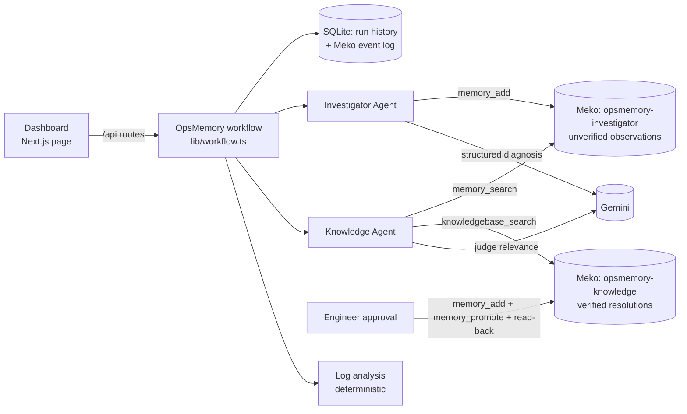

# OpsMemory

**Incident investigation that remembers what your engineers verified.** OpsMemory is a hackathon prototype (HackCBS 9.0, Meko Open Innovation Challenge, Track A). Two AI agents investigate production incidents. An engineer reviews each investigation. Approved resolutions are promoted into [Meko](https://mekodata.ai) as verified knowledge, so later investigations recall them before reasoning.

> **Prototype, not production software.** All incidents and logs are synthetic, and OpsMemory makes no changes to real infrastructure. Recommendations are text for a human to act on. Nothing becomes verified knowledge without an engineer's approval.

## Problem

Incident knowledge is lost between incidents. The engineer who fixed last quarter's outage knew a crucial constraint, for example that the shared database allows 200 connections and each service may use 80. That fact lived in their head or in a chat thread. When a different service has the same class of failure, responders and AI assistants start from scratch and guess values that may be unsafe.

**Persona.** Priya is an on-call SRE at a mid-size e-commerce company. Three months ago a colleague fixed a checkout-api outage after the DBA explained that the shared Postgres cluster allows 200 connections and each service gets a budget of 80. Tonight orders-api fails the same way during a flash sale. Priya has never seen that incident, and the logs don't mention the limit. She needs the verified fix and its constraint, not a fresh guess.

## Solution

OpsMemory turns engineer-verified resolutions into durable, retrievable institutional memory:

- **Recall before reasoning.** A Knowledge Agent searches Meko for verified resolutions and earlier observations, then judges which ones actually apply.
- **Traceable reasoning.** Every configuration value the Investigator suggests is labelled with its source: `current_evidence` (this incident's logs), `history:K#` (a recalled memory) or `assumption`. An integrity check compares cited numbers against the cited source.
- **Human-gated learning.** Only an engineer's approval promotes a resolution into Meko's shared knowledge base. Unapproved findings stay in a separate datapack as unverified observations.
- **A measurable difference.** The same incident can be run with Meko ON and Meko OFF, with the same model, prompt and inputs. The dashboard compares the two runs.

## How it works: the incident lifecycle

| Stage | What happens | Meko |
|---|---|---|
| 1. Recall | The Knowledge Agent runs `knowledgebase_search` (verified knowledge) and `memory_search` (earlier observations). Gemini then classifies each item as relevant or not, with a reason. | Reads both runtime datapacks |
| 2. Reason | Log analysis (plain code, no LLM) groups log lines into patterns. The Investigator (Gemini) writes a structured diagnosis: root cause, evidence, config changes with sources, open questions, confidence. | None |
| 3. Record | The Investigator's finding is stored as an **unverified** observation. | Writes `investigator` |
| 4. Review | An engineer approves (optionally editing the root cause, fix and notes) or rejects. | — |
| 5. Promote | On approval the resolution is written, promoted into the knowledge base, then **read back** with `knowledgebase_search`. It counts as approved only if the read-back finds it. | Writes and promotes in `knowledge` |
| 6. Reuse | The next related incident recalls it in stage 1. | Reads `knowledge` |

A rejection keeps the rejected hypothesis as an unverified observation and promotes nothing. Any unverified observation can be **forgotten** (deleted from Meko) from the UI.



SQLite holds application state only: investigations, decisions, and a log of every Meko call shown in the activity timeline. **It is never used for recall.** Historical knowledge comes only from Meko.

## Technology stack

- Next.js 16 (App Router), React 19, Tailwind CSS 4, TypeScript (strict)
- Meko via its MCP server (`@modelcontextprotocol/sdk`, Streamable HTTP)
- Google Gemini (`@google/genai`), default `gemini-3.5-flash-lite`, with JSON-schema output. The provider layer (`lib/llm/`) is modular, and a Groq provider is planned but **not implemented**.
- `node:sqlite` for local state; zod for validating every LLM and Meko response

## The two agents

**Knowledge Agent** (`lib/agents/knowledge.ts`, runs only with Meko ON):
- searches the `knowledge` datapack (verified resolutions) and the `investigator` datapack (earlier unverified observations);
- labels each item VERIFIED, RUNBOOK or UNVERIFIED;
- asks Gemini whether each item applies to this incident, judging by mechanism and the item's "Applies when" conditions rather than by service name.

It returns a brief listing retrieved items, relevant items with reasons, and rejected items with reasons. It never writes.

**Investigator Agent** (`lib/agents/investigator.ts`):
- receives the incident, the log analysis and the Knowledge Agent's *relevant* items. With Meko OFF it receives an explicit "no historical context" block instead.
- produces a zod-validated diagnosis, in which every config value must name its source;
- passes through integrity checks that flag numbers not found in the cited source, and references to memories that weren't provided.

With Meko ON it records its finding in the `investigator` datapack.

## How Meko is used, and why it is essential

Meko is OpsMemory's only long-term memory, with no local substitute. If Meko is unreachable, a Meko ON investigation **fails visibly**. It never silently degrades to OFF.

| Datapack | Holds | Read by | Written by |
|---|---|---|---|
| `opsmemory-knowledge` | Engineer-approved, promoted resolutions | Knowledge Agent (`knowledgebase_search`); the approval read-back | Engineer approval (`conversation_create`, `memory_add`, `memory_promote`) |
| `opsmemory-investigator` | Unverified findings and rejected hypotheses | Knowledge Agent (`memory_search`); forget read-back | Investigator (`conversation_create`, `conversation_add_message`, `memory_add`); rejections; forget (`memory_delete_by_id`) |

- **Isolation is by datapack.** Meko's `agent_id` does not filter reads, so an app-level policy (`lib/meko/scopes.ts`) blocks each actor from datapacks it may not use *before* the call is made. For example, the Investigator cannot read either datapack; it receives history only through the Knowledge Agent's brief.
- **Verified means promoted.** `memory_promote` moves a memory out of private memory into the knowledge base, where `knowledgebase_search` returns it tagged with its `memory_id`. That id is shown in the UI as provenance.

### Meko features used, and why

| Meko feature (A2) | Where | Why OpsMemory needs it |
|---|---|---|
| **Datapacks as scopes** | `opsmemory-knowledge` vs `opsmemory-investigator`; policy in `lib/meko/scopes.ts` | Verified knowledge and unverified agent observations must never mix. `agent_id` doesn't filter reads, so the datapack is the real trust boundary. |
| **Recall before reasoning** | Knowledge Agent (`lib/agents/knowledge.ts`) | The org-specific constraint (200 connections, 80 per service) isn't in tonight's logs. It exists only in memory, so it must be recalled *before* the Investigator reasons. |
| **Promotion to shared knowledge** | Engineer approval (`OpsMemory.approve`) | Promotion is the human verification step. Only promoted resolutions are labelled VERIFIED, and agents treat unpromoted observations as hints. |
| **Sharing across agents** | The Investigator writes findings; the Knowledge Agent recalls them in later incidents | What one agent observed reaches the next investigation without the agents calling each other. Promoted knowledge is shared with every future run. |
| **Extracted memories** | `conversation_add_message` in `recordInvestigation` | Each investigation is stored as a conversation, and Meko extracts memories from it alongside the explicit finding. OpsMemory doesn't depend on the extracted copies. |

### Correct and forget (A4)

- **Correct:** before approving, the engineer can edit the root cause and fix and add notes. What gets promoted is the corrected text.
- **Forget:** any unverified observation (the Investigator's own finding, or one recalled from an earlier run) has a **Forget** button. It deletes the memory with `memory_delete_by_id`, and the UI shows "Forgotten from Meko" only after a read-back returns `not_found`.
- **Promoted knowledge:** it can't be forgotten through Meko's API (see the feature proposal), so the UI says so instead of offering a button.

### Meko ON vs Meko OFF

| | Meko ON | Meko OFF |
|---|---|---|
| Knowledge Agent | Runs; recalls from both datapacks | Does not run |
| Investigator input | Incident + logs + relevant recalled items | Incident + logs + "no historical context" |
| Meko calls | Connection set-up, 2 searches, ~3 writes | **Zero.** No connection is opened. |
| Approval | Possible (promotes into Meko) | Not possible: OFF runs are for comparison only |

The model, prompt template and inputs are otherwise identical. In the demo scenario, incident 2's logs show the symptoms (pods scaling out, connections exhausted) but never the database limit. With Meko ON, the verified constraint is recalled and cited as `history:K1`. With Meko OFF, the values are assumptions and the limit appears as an open question. In the last recorded e2e run, the verified constraint appeared in 3/3 ON runs and 0/3 OFF runs. LLM output varies between runs.

## Approval reliability

Meko has no transactions or idempotency keys, so approval is a **resumable sequence** with each confirmed step persisted in SQLite (`lib/workflow.ts` `approve`):

1. **Every step is checked and saved.** The four steps are `conversation_create`, `memory_add`, `memory_promote` and the `knowledgebase_search` read-back. Each Meko-confirmed step is persisted immediately.
2. **Only a successful read-back stores `approved`.** Every other outcome is a distinct status, shown in the run history and the approval panel:
   - `approval_failed`: a definite failure;
   - `promotion_unverified`: the promotion was acknowledged but the read-back missed it;
   - `needs_reconciliation`: a write's outcome is unknown.
3. **Ambiguous writes are never retried automatically.** The Meko client does not resend a non-idempotent write after a transport error; it reports `uncertain_outcome` instead.
4. **"Retry approval" resumes; it doesn't restart.** It continues after the last confirmed step. If an earlier write's outcome is unknown, it first lists the approval conversation's memories (`memory_get_all`, personal and promoted) and adopts what is already there. It writes again only when the listing proves nothing was stored.
5. **Repeated and concurrent clicks are safe.** An atomic SQLite claim (`approving`) refuses a concurrent second approval, and re-approving an `approved` investigation makes no Meko calls.

The remaining limits are listed under [Known limitations](#known-limitations).

## Environment variables

Copy `.env.example` to `.env.local` and fill in your own values. Never commit `.env.local` (it is git-ignored).

| Variable | Required | Default | Purpose |
|---|---|---|---|
| `MEKO_API_KEY` | yes | — | Runtime Meko key for **this app** (create at cloud.mekodata.ai → Settings → API Keys). Do not reuse your coding agent's key. |
| `GEMINI_API_KEY` | yes | — | Google AI Studio key |
| `GEMINI_MODEL` | recommended | `gemini-3.8-flash` if unset | Set to `gemini-3.5-flash-lite` (as in `.env.example`). The fallback took 90–140s per call in testing. |
| `LLM_PROVIDER` | no | `gemini` | Only `gemini` is implemented |
| `GEMINI_THINKING_LEVEL` | no | `LOW` | `MINIMAL`, `LOW`, `MEDIUM` or `HIGH` |
| `MEKO_DATAPACK_PREFIX` | no | `opsmemory` | Datapacks are `<prefix>-knowledge` and `<prefix>-investigator`, created automatically if missing |
| `OPSMEMORY_DB` | no | `data/opsmemory.db` | SQLite file for run history and the event log |

```bash
MEKO_API_KEY=your-meko-runtime-key
GEMINI_API_KEY=your-gemini-key
GEMINI_MODEL=gemini-3.5-flash-lite
```

## Setup and run

Prerequisites: Node.js 24 or newer (uses the built-in `node:sqlite`; tested on Node 26), a Meko account and a Gemini API key.

```bash
npm install
```

```bash
cp .env.example .env.local
```

Edit `.env.local` and set `MEKO_API_KEY` and `GEMINI_API_KEY`, then:

```bash
npm run dev
```

Open http://localhost:3000. For a production build, use `npm run build` and then `npm start`.

## Demo script

`npm run dev` uses the **demo datapacks** (`opsmemory-knowledge`, `opsmemory-investigator`). Promoted memories cannot be deleted through Meko's API, so each approval is permanent. To practise, run `npm run dev:rehearse` instead. It uses the separate `opsmemory-e2e-*` datapacks, `data/ui-rehearsal.db` and port 3100.

1. Select **db-pool-1** (checkout-api, connection pool exhaustion), Meko **ON**, and click **Investigate**. Nothing verified exists yet.
2. In the approval panel, click **Apply engineer edit**. This applies the DBA-validated constraint: pool max 8, maxReplicas 10, and checkout-api's budget of 80 of the database's 200 connections. Then click **Approve & promote to Meko**. The panel shows **Approved, promoted and verified** only after the read-back succeeds.
3. Select **db-pool-2** (orders-api, a different service on the same database), Meko **ON**. The Knowledge Agent recalls the verified resolution, and config values are sourced `history:K1`.
4. Click **Run with Meko OFF** in the comparison panel. The OFF run makes zero Meko calls, its values are assumptions, and the database limit is an open question.

The lifecycle strip, Meko activity timeline and run history show only what the backend recorded.

**Resetting the local dashboard.** `npm run demo:reset` is a dry run that shows what would be cleared. `npm run demo:reset -- --confirm` deletes the run history and Meko activity log from `data/opsmemory.db`. It never contacts Meko, so promoted memories stay. It refuses any other database or datapack prefix.

## Testing

| Command | Talks to | Datapacks / DB | Notes |
|---|---|---|---|
| `npm run typecheck` | nothing | — | TypeScript check |
| `npm run test:approval` | nothing (in-memory Meko fake, **test-only**) | temporary SQLite | Approval state machine: verified-only `approved`, retry without duplicates, double-click, schema migration |
| `npm run e2e` | live Meko + Gemini | `opsmemory-e2e-*`, `data/e2e.db` | Full lifecycle; promotes into the **e2e** datapacks. `E2E_RUNS=1 npm run e2e` uses less quota. |
| `npm run check:llm` / `bench:llm` | Gemini | — | Model availability, JSON output, latency |
| `npm run spike:meko` | live Meko | `opsmemory-spike` | API exploration |
| `npm run check:scopes` | live Meko | **demo** datapacks + `opsmemory-spike` | Writes short-lived markers into the demo investigator datapack, then deletes them. Do not run right before a demo. |
| `npm run ops` | live Meko + Gemini | **demo** datapacks unless `MEKO_DATAPACK_PREFIX` is set | CLI for the same workflow. `ops approve` promotes permanently. |

Meko's free tier has lifetime quotas (1,000 calls each for `memory_search`, `knowledgebase_search`, `context_search` and `conversation_add_message`). Each ON investigation uses two searches and one message.

## Build-time vs runtime Meko

This project uses Meko in two **independent** ways. They use different credentials and different datapacks.

- **Build-time Meko is the coding agent's memory.** Claude Code connected to Meko with its own MCP credentials and recorded development decisions in the `opsmemory-build` datapack. The application never reads or writes it.
- **Runtime Meko is OpsMemory's institutional memory.** The app's agents use `MEKO_API_KEY` and the `opsmemory-knowledge` and `opsmemory-investigator` datapacks. Claude Code's context is never written there.

Details are in [docs/MEKO_USAGE.md](docs/MEKO_USAGE.md).

## Known limitations

- **No authentication.** Anyone who can reach the server can approve, and approvals promote permanently. Run it locally only.
- **Promotion cannot be undone through Meko's API.** Correcting or retracting a promoted resolution requires the Meko portal. Forget works only for unverified observations, and not for memories Meko auto-extracted from investigation conversations, which the UI doesn't list.
- **Not exactly-once.** Approval writes can still duplicate in two edge cases:
  - Reconciliation lists `memory_get_all` with 100-row pages and checks only the first page. If either listing is larger than that, an unknown outcome stays `needs_reconciliation` instead of guessing.
  - An uncertain `conversation_create` can leave an empty orphan conversation, which is harmless.
- **Investigator writes and rejections are not reconciled.** They are not retried after an ambiguous failure, so they may be missing, but they never duplicate. Their write IDs are not read back.
- **Progress during a run is coarse.** The backend has no streaming, so the in-progress lifecycle shows only Meko events recorded so far. Reasoning is reported when the run returns.
- **Single process.** Workflow calls are serialised in one Next.js server process.
- **LLM output varies.** The ON/OFF difference is measured, not guaranteed. Retrieved memory text is passed to the LLM unfiltered (no prompt-injection hardening).
- **Synthetic data only.** No real monitoring, cloud or remediation integrations exist.

Meko product feedback from building this is in [docs/MEKO_FEATURE_PROPOSAL.md](docs/MEKO_FEATURE_PROPOSAL.md) and [docs/FRICTION_LOG.md](docs/FRICTION_LOG.md).
